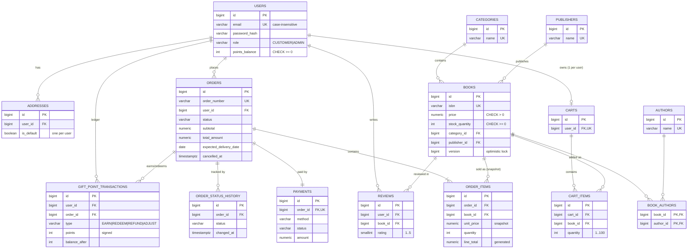

# EBookStore - Database Design (PostgreSQL)

Source of truth: Flyway migrations in `backend/src/main/resources/db/migration/`

| File | Content |
|---|---|
| `V1__create_schema.sql` | Tables, constraints, indexes, triggers |
| `V2__seed_catalogue.sql` | 8 categories, 8 publishers, 26 books, 30 authors |

The schema is verified by `SchemaMigrationTest` (11 tests on a real embedded PostgreSQL). Hibernate runs with `ddl-auto: validate`, so Flyway owns the schema.

## 1. Assumptions

| # | Assumption |
|---|---|
| D1 | Primary keys are `BIGINT GENERATED ALWAYS AS IDENTITY` (JPA: `@GeneratedValue(strategy = IDENTITY)`). |
| D2 | Money is `NUMERIC(10,2)` for unit prices and `NUMERIC(12,2)` for order totals. Single currency. Points are `INTEGER` (1 point = 1 currency unit). |
| D3 | Enum-like columns are `VARCHAR` with a `CHECK` list (JPA: `@Enumerated(EnumType.STRING)`). I avoided native PG enums because they are awkward to change and to map in JPA. |
| D4 | Timestamps are `TIMESTAMPTZ`. The tentative delivery date is a `DATE`. |
| D5 | Three tables were added beyond your list because the approved requirements need them: `authors` and `book_authors` (a book can have several authors, search by author, related books) and `order_status_history` (FR-14 tracking timeline). |
| D6 | **No `product_relationships` table.** Related books and recommendations are derived with queries (same category, author or publisher). A manual mapping table would duplicate that data. It can be added later if editors need hand-picked related books. |
| D7 | Books are never hard-deleted. `active = false` hides them, because order history references them (`ON DELETE RESTRICT`). |
| D8 | The order stores a **copy of the delivery address** (`shipping_*`), not a foreign key to `addresses`. Editing or deleting an address must not rewrite history. |
| D9 | One payment per order (`UNIQUE(order_id)`). A cancelled order's payment becomes `REFUNDED` (simulated). |
| D10 | **Open point:** the plan says a failed payment creates no order. If the service rolls back on failure, `payments.status = FAILED` is never stored. If you want failed attempts kept for audit, store the order and payment first, then mark them failed. |
| D11 | Passwords: the application hashes with BCrypt or Argon2. The database also rejects any value that is not in `$alg$...` hash format, as a safety net against plain text. |
| D12 | Points are earned on delivery (approved A5). The ledger therefore records `EARN` when an order becomes `DELIVERED`. `orders.points_earned` holds the amount that will be or was earned. |

## 2. Entity relationship diagram

## 3. Data dictionary

Every table below also has `id BIGINT` (identity primary key) unless the key is stated otherwise. `created_at` and `updated_at` are `TIMESTAMPTZ NOT NULL DEFAULT now()`. `updated_at` is refreshed by a trigger.

### users
| Column | Type | Null | Notes |
|---|---|---|---|
| full_name | VARCHAR(100) | N | |
| email | VARCHAR(254) | N | Unique ignoring case (`ux_users_email_lower`). Must contain one `@`. |
| password_hash | VARCHAR(255) | N | Must match `$alg$...` hash format (`ck_users_password_hash`). |
| phone | VARCHAR(20) | Y | Digits and `+ - ( )` only. |
| role | VARCHAR(20) | N | `CUSTOMER` (default) or `ADMIN`. |
| points_balance | INTEGER | N | Default 0. `CHECK >= 0`. Maintained by the ledger trigger, never set by the app directly. |
| enabled | BOOLEAN | N | Default true. Lets you disable an account without deleting it. |

### addresses
| Column | Type | Null | Notes |
|---|---|---|---|
| user_id | BIGINT | N | FK to users, `ON DELETE CASCADE`. |
| recipient_name, phone | VARCHAR | N | |
| line1 / line2 | VARCHAR(150) | N / Y | |
| city, state | VARCHAR(80) | N | |
| postal_code | VARCHAR(12) | N | |
| country_code | VARCHAR(2) | N | ISO code, default `IN`. |
| is_default | BOOLEAN | N | At most one true per user (`ux_addresses_one_default`, partial unique index). |

### categories / publishers / authors
| Column | Type | Null | Notes |
|---|---|---|---|
| name | VARCHAR(80 / 120 / 120) | N | Unique ignoring case. |
| description | VARCHAR(500) | Y | Not present on authors. |

### books
| Column | Type | Null | Notes |
|---|---|---|---|
| title | VARCHAR(255) | N | Index on `lower(title)` for search. |
| isbn | VARCHAR(13) | N | Unique, exactly 13 digits. |
| description | TEXT | Y | |
| price | NUMERIC(10,2) | N | `CHECK > 0`. |
| stock_quantity | INTEGER | N | `CHECK >= 0`. Default 0. |
| image_url | VARCHAR(500) | Y | |
| published_year | INTEGER | Y | 1400 to 2100. |
| rating_avg | NUMERIC(3,2) | N | 0 to 5. Maintained by trigger from `reviews`. |
| rating_count | INTEGER | N | `CHECK >= 0`. Maintained by trigger. |
| active | BOOLEAN | N | Soft delete flag. |
| version | BIGINT | N | For JPA `@Version`. Prevents overselling under concurrent checkout. |
| category_id | BIGINT | N | FK to categories, `ON DELETE RESTRICT`. |
| publisher_id | BIGINT | N | FK to publishers, `ON DELETE RESTRICT`. |

### book_authors
Composite primary key (`book_id`, `author_id`). Both are foreign keys with `ON DELETE CASCADE`. Extra index on `author_id`.

### carts
| Column | Type | Null | Notes |
|---|---|---|---|
| user_id | BIGINT | N | FK to users (cascade). Unique, so one cart per user. |

### cart_items
| Column | Type | Null | Notes |
|---|---|---|---|
| cart_id | BIGINT | N | FK to carts (cascade). |
| book_id | BIGINT | N | FK to books (restrict). Unique with `cart_id`, so one line per book. |
| quantity | INTEGER | N | `CHECK BETWEEN 1 AND 100`. |

### orders
| Column | Type | Null | Notes |
|---|---|---|---|
| order_number | VARCHAR(30) | N | Unique, customer-facing. |
| user_id | BIGINT | N | FK to users (restrict). |
| status | VARCHAR(20) | N | `PLACED`, `CONFIRMED`, `PACKED`, `SHIPPED`, `DELIVERED`, `CANCELLED`. |
| shipping_* (8 columns) | VARCHAR | N / Y | Address snapshot. |
| subtotal | NUMERIC(12,2) | N | Sum of line totals. |
| points_redeemed | INTEGER | N | |
| points_discount | NUMERIC(12,2) | N | `CHECK <= subtotal`. |
| total_amount | NUMERIC(12,2) | N | Must equal `subtotal - points_discount`. |
| points_earned | INTEGER | N | |
| expected_delivery_date | DATE | N | Tentative delivery date. |
| delivered_at | TIMESTAMPTZ | Y | Set only when status is `DELIVERED`. |
| cancelled_at | TIMESTAMPTZ | Y | Set only when status is `CANCELLED`. Must not be earlier than `created_at`. |
| cancel_reason | VARCHAR(255) | Y | Only allowed when cancelled. |
| created_at | TIMESTAMPTZ | N | This is the order creation time. The 48-hour window is measured from it. |

### order_items
| Column | Type | Null | Notes |
|---|---|---|---|
| order_id | BIGINT | N | FK to orders (cascade). Unique with `book_id`. |
| book_id | BIGINT | N | FK to books (restrict). |
| book_title, book_isbn | VARCHAR | N | Snapshot of the book at purchase. |
| unit_price | NUMERIC(10,2) | N | Snapshot of the price paid. `CHECK >= 0`. |
| quantity | INTEGER | N | `CHECK BETWEEN 1 AND 100`. |
| line_total | NUMERIC(12,2) | N | Generated: `unit_price * quantity`. |

### order_status_history
| Column | Type | Null | Notes |
|---|---|---|---|
| order_id | BIGINT | N | FK to orders (cascade). |
| status | VARCHAR(20) | N | Same allowed values as `orders.status`. |
| note | VARCHAR(255) | Y | |
| changed_at | TIMESTAMPTZ | N | Index on (`order_id`, `changed_at`). |

### payments
| Column | Type | Null | Notes |
|---|---|---|---|
| order_id | BIGINT | N | FK to orders (restrict). Unique, so one payment per order. |
| method | VARCHAR(20) | N | `CARD`, `UPI`, `COD`, `GIFT_POINTS`. |
| status | VARCHAR(20) | N | `PENDING` (default), `SUCCESS`, `FAILED`, `REFUNDED`. |
| amount | NUMERIC(12,2) | N | `CHECK >= 0`. |
| transaction_ref | VARCHAR(64) | Y | Reference from the mock gateway. No card data is stored. |
| failure_reason | VARCHAR(255) | Y | |
| paid_at | TIMESTAMPTZ | Y | Required when status is `SUCCESS` or `REFUNDED`. |
| refunded_at | TIMESTAMPTZ | Y | Set exactly when status is `REFUNDED`. |

### gift_point_transactions
| Column | Type | Null | Notes |
|---|---|---|---|
| user_id | BIGINT | N | FK to users (restrict). |
| order_id | BIGINT | Y | FK to orders (restrict). Required unless type is `ADJUST`. |
| type | VARCHAR(10) | N | `EARN`, `REDEEM`, `REFUND`, `ADJUST`. |
| points | INTEGER | N | Signed, never 0. `EARN` and `REFUND` are positive, `REDEEM` is negative. |
| balance_after | INTEGER | N | Running balance, filled by the trigger. |
| description | VARCHAR(255) | Y | |
| created_at | TIMESTAMPTZ | N | No `updated_at`, because rows are append-only. |

### reviews (optional)
| Column | Type | Null | Notes |
|---|---|---|---|
| user_id | BIGINT | N | FK to users (cascade). Unique with `book_id`. |
| book_id | BIGINT | N | FK to books (cascade). |
| rating | SMALLINT | N | `CHECK BETWEEN 1 AND 5`. |
| title / comment | VARCHAR(120) / VARCHAR(2000) | Y | |

## 4. Relationships and key constraints explained

**Ownership and cardinality**
- `users 1-N addresses`: deleting a user removes their addresses.
- `users 1-1 carts`: enforced by `UNIQUE(user_id)`. `carts 1-N cart_items`, with `UNIQUE(cart_id, book_id)` so adding the same book twice must update the quantity (FR-5).
- `categories 1-N books` and `publishers 1-N books`: `ON DELETE RESTRICT`, so a category or publisher that still has books cannot be removed.
- `books N-N authors` through `book_authors`.
- `users 1-N orders`, `orders 1-N order_items`, `orders 1-1 payments`: deleting an order is possible only if it has no payment or ledger rows. In practice orders are kept forever.

**Order snapshot (FR-10)**
- `order_items` stores title, ISBN, `unit_price` and `quantity`, and the order stores the shipping address. Changing a book price later never changes past orders. The test `orderSnapshotPaymentAndCancellationRules` proves this.
- `books` rows cannot be deleted once they appear in an order (`fk_order_items_book`, `RESTRICT`). Use `active = false` instead.

**Money and amount integrity**
- All money is `NUMERIC`, never float. `ck_orders_amounts` guarantees `total_amount = subtotal - points_discount`, no negative amounts, and a discount no larger than the subtotal.
- `line_total` is a generated column, so it can never disagree with price and quantity.
- The database checks consistency, but the service still computes the values. For example it must check that `subtotal` equals the sum of `line_total`.

**Order lifecycle (FR-13, FR-14)**
- `status = CANCELLED` if and only if `cancelled_at IS NOT NULL` (`ck_orders_cancel_state`). The same rule links `DELIVERED` and `delivered_at`.
- The 48-hour window and the allowed statuses are business rules checked in the service, because they depend on the current time. The columns needed (`created_at`, `status`, `cancelled_at`) are all present.
- `order_status_history` gives the timeline shown to the customer.

**Gift points ledger (FR-9)**
- `gift_point_transactions` is the audit trail. A `BEFORE INSERT` trigger updates `users.points_balance` and stores `balance_after`. Since `users.points_balance` has `CHECK >= 0`, a redemption larger than the balance **fails the whole insert**. The test confirms this.
- Rows cannot be updated or deleted (trigger `trg_gpt_append_only`). A correction is a new `ADJUST` row.
- `ux_gpt_once_per_order` allows one `EARN`, one `REDEEM` and one `REFUND` per order. This prevents double crediting when a request is retried.
- The 50% cap on redemption and the earn rate are service rules.

**Other rules in the database**
- Cart and order quantities must be between 1 and 100. The business limit of 10 per cart line is applied in the service so it can be configured without a migration.
- Stock cannot go below zero (`ck_books_stock`). Combined with `@Version`, two simultaneous buyers cannot oversell the last copy.
- Ratings stay in sync with reviews through the `trg_reviews_rating` trigger. One review per user per book.

**Indexes**
- Foreign keys that the application filters by are indexed: `books(category_id)`, `books(publisher_id)`, `orders(user_id, created_at DESC)` for order history, `order_items(book_id)` for recommendations and buy-again, and `gift_point_transactions(user_id, created_at DESC)` for the points history.
- `lower(title)` supports case-insensitive search. At about 1,000 books this is enough. If search must be faster, add `pg_trgm` later.

## 5. Notes for Spring Data JPA entities (next phase)

- Use `@GeneratedValue(strategy = GenerationType.IDENTITY)` for all ids.
- Map `books.version` with `@Version`.
- Mark these columns as read-only in the entities (`insertable = false, updatable = false`) because triggers or generated expressions own them: `users.points_balance`, `gift_point_transactions.balance_after`, `order_items.line_total`, `books.rating_avg`, `books.rating_count`, and every `updated_at`.
- Make `GiftPointTransaction` an immutable entity (no setters, never updated).
- Use `@Enumerated(EnumType.STRING)` for `role`, `status`, `method` and `type`.
- Use `BigDecimal` for money and `Instant` or `OffsetDateTime` for timestamps.
- Use `LAZY` for all `@ManyToOne` and `@OneToMany` associations.

## 6. Seed data (V2)

| Item | Count | Notes |
|---|---|---|
| Categories | 8 | Fiction, Non-Fiction, Science, Programming, Business, Self-Help, History, Children |
| Publishers | 8 | Penguin Random House, HarperCollins, Bloomsbury, Simon & Schuster, Oxford University Press, Pearson, O'Reilly Media, Manning Publications |
| Books | 26 | Prices 249.00 to 1199.00, stock 12 to 60 |
| Authors | 30 | Linked through `book_authors` |

The titles and authors are real. **ISBNs, prices, stock levels and descriptions are made-up development values**, and the ISBNs are not real. Replace them before any real use. The seed contains no users and no passwords.

